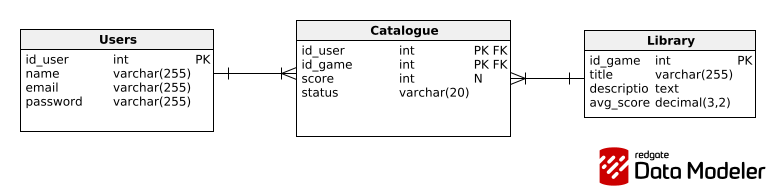

# Web-MyGameList

Servidor web creado por Valentina Bianchi y Maximo Billordo para la materia Programación Web, de la carrera Ingeniería de Sistemas de la UNICEN.

## Descripción

MyGameList es una aplicación para llevar un catálogo de los juegos favoritos de una persona. Para cada juego se guarda un título, una calificación (de 1 a 5 estrellas) y un estado (Por jugar, Jugando, Completado, Platinado).

## Modelo de datos

El esquema de la base de datos (PostgreSQL) está compuesto por tres tablas:

* **Users**: usuarios registrados en la aplicación (id, nombre, email, contraseña).
* **Library**: catálogo global de juegos disponibles (id, título, descripción, calificación promedio).
* **Catalogue**: tabla intermedia que representa la lista personal de cada usuario (qué juego tiene agregado, con qué puntaje y en qué estado).

El esquema completo se encuentra en `db/schema/schema.sql`, y las consultas SQL utilizadas para generar el código de acceso a datos están en `db/queries/queries.sql`.
### Modelo relacional


## Requisitos

* Si no está instalado, usar el siguiente comando para instalar docker-compose: `sudo apt install docker-compose-v2`
* Verificar la instalación con: `docker compose version`

## Cómo ejecutar el servidor

Todo corre dentro de contenedores Docker (servidor y PostgreSQL), sin instalar Go ni PostgreSQL en la máquina host. Desde la raíz del proyecto:

```bash
cd servidor-web
make run
```

Esto construye la imagen del servidor, levanta PostgreSQL con el esquema de `db/schema/schema.sql`, genera el código con `sqlc` y `templ`, y deja el servidor escuchando en `http://localhost:8080`. El servidor se compila al arrancar el contenedor, por lo que puede tardar unos segundos en responder. Se detiene con `Ctrl+C`, y al hacerlo se eliminan los contenedores y los datos. También se puede usar `make clean`.

## Interfaz web (TP4 y TP5)

Al correr `make run` y abrir `http://localhost:8080` se muestra la página principal, donde se puede:

- **Cargar un juego** con el formulario (título y descripción).
- **Ver la biblioteca** como tarjetas.
- **Borrar un juego** con el botón de cada tarjeta.

En el TP4 el frontend estaba hecho con HTML, CSS y JavaScript, y consumía la API REST del TP3. A partir del TP5 la interfaz se renderiza en el servidor: las vistas son componentes `templ` (en `views/`: layout, formulario, lista y la página principal), el estilo viene de Pico.css (cargado por CDN) y no hay JavaScript. El formulario envía un `POST` y el servidor responde con una redirección a `/` (patrón Post/Redirect/Get), por lo que cada acción recarga la página completa.

## Rutas

| Método y URL                | Descripción                                | Respuestas              |
| --------------------------- | ------------------------------------------ | ----------------------- |
| `GET /`                     | Muestra el formulario y la lista de juegos | 200, 404, 405, 500      |
| `POST /library`             | Crea un juego y redirige a `/`             | 303, 400, 405, 500      |
| `POST /library/{id}/delete` | Elimina un juego y redirige a `/`          | 303, 400, 404, 405, 500 |

El borrado usa `POST` y no `DELETE` porque los formularios HTML solo admiten `GET` y `POST`. Los errores devuelven un mensaje de texto.

## Cómo correr los tests de la capa de datos

Todo el flujo de testing está automatizado con un `Makefile`, que se apoya en `docker compose` para levantar una base de datos PostgreSQL limpia, generar el código con `sqlc` y `templ`, compilar el proyecto y correr los tests, sin necesidad de tener PostgreSQL, Go ni `sqlc` instalados en la máquina host (todo corre dentro de contenedores Docker).

Para correr los tests, desde la raíz del proyecto:

```bash
cd servidor-web
make test
```

Esto ejecuta, en orden:

1. Limpieza de cualquier contenedor o volumen previo (`docker compose down -v`).
2. Construcción de la imagen donde corren los tests (`docker compose build test`).
3. Levantamiento del contenedor de PostgreSQL, esperando a que esté listo para aceptar conexiones (`healthcheck`).
4. Dentro de un contenedor: generación del código con `sqlc generate` y `templ generate`, compilación (`go build`) y ejecución de los tests (`go test ./... -v`).
5. Limpieza de los contenedores y volúmenes al finalizar, tanto si los tests pasaron como si fallaron.

## Decisiones de diseño (TP5)

- El borrado usa `POST /library/{id}/delete`, porque los formularios HTML no soportan `DELETE`.
- Se reutilizaron las validaciones del TP3. Ante un dato inválido se responde con el mensaje de error en texto plano y el código 400, sin volver a mostrar el formulario.
- Se eliminaron las rutas de usuarios y catálogo: el enunciado trabaja con una sola entidad en la raíz.

## Limitaciones conocidas

- La primera vez la base puede tardar varios segundos en inicializarse.
- Por el momento no hay autenticación ni autorización: cualquier cliente puede ver y modificar la biblioteca.
- La aplicación solo expone la biblioteca de juegos: los usuarios y el catálogo personal existen en la base de datos, pero todavía no tienen interfaz.
- No hay restricción de título único en `Library`.