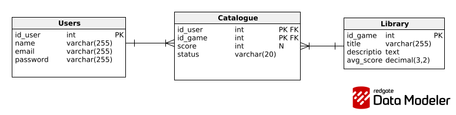

# Web-MyGameList

Servidor web creado por Valentina Bianchi y Maximo Billordo para la materia Programación Web, de la carrera Ingeniería de Sistemas de la UNICEN.

## Descripción

MyGameList es una aplicación para llevar un catálogo de los juegos favoritos de una persona. Para cada juego se guarda un título, una calificación (de 1 a 5 estrellas) y un estado (Por jugar, Jugando, Completado, Platinado).

## Modelo de datos

El esquema de la base de datos (PostgreSQL) está compuesto por tres tablas:

* **Users**: usuarios registrados en la aplicación (id, nombre, email, contraseña).
* **Library**: catálogo global de juegos disponibles (id, título, descripción, calificación promedio).
* **Catalogue**: tabla intermedia que representa la lista personal de cada usuario (qué juego tiene agregado, con qué puntaje y en qué estado).

El esquema completo se encuentra en `db/schema/schema.sql`, y las consultas SQL utilizadas para generar el código de acceso a datos están en `db/queries/queries.sql`.
### Modelo relacional


## Requisitos

* Si no está instalado, usar el siguiente comando para instalar docker-compose: `sudo apt install docker-compose-v2`
* Verificar la instalación con: `docker compose version`

## Cómo ejecutar el servidor

Todo corre dentro de contenedores Docker (servidor y PostgreSQL), sin instalar Go ni PostgreSQL en la máquina host. Desde la raíz del proyecto:

```bash
cd servidor-web
make run
```

Esto construye la imagen del servidor, levanta PostgreSQL con el esquema de `db/schema/schema.sql`, genera el código con `sqlc` y `templ`, y deja el servidor escuchando en `http://localhost:8080`. El servidor se compila al arrancar el contenedor, por lo que puede tardar unos segundos en responder. Se detiene con `Ctrl+C`, y al hacerlo se eliminan los contenedores y los datos. También se puede usar `make clean`.

## Interfaz web (TP4, TP5 y TP6)

Al correr `make run` y abrir `http://localhost:8080` se muestra la página principal, donde se puede:

- **Cargar un juego** con el formulario (título y descripción).
- **Ver la biblioteca** como tarjetas.
- **Borrar un juego** con el botón de cada tarjeta.

En el TP4 el frontend estaba hecho con HTML, CSS y JavaScript, y consumía la API REST del TP3. A partir del TP5 la interfaz se renderiza en el servidor: las vistas son componentes `templ` (en `views/`: layout, formulario, lista y la página principal) y el estilo viene de Pico.css (cargado por CDN).

En el TP6 la interfaz pasó a ser reactiva con [HTMX](https://htmx.org/) 4.0, cargado por CDN en el layout. Crear o borrar un juego ya no recarga la página: el formulario y los botones envían la petición con atributos HTMX (`hx-post`, `hx-delete`, `hx-target`, `hx-swap`) y el servidor responde solo con el fragmento de HTML que cambia (la lista de juegos, o nada en el caso del borrado). Sigue sin haber archivos JavaScript propios.

## Rutas

| Método y URL           | Descripción                                                | Respuestas         |
| ---------------------- | ---------------------------------------------------------- | ------------------ |
| `GET /`                | Muestra la página completa: formulario y lista de juegos   | 200, 404, 405, 500 |
| `POST /library`        | Crea un juego y devuelve la lista actualizada (fragmento)  | 200, 400, 405, 500 |
| `DELETE /library/{id}` | Elimina un juego y devuelve una respuesta vacía            | 200, 400, 404, 405, 500 |

En `POST /library`, los errores 400 y 500 devuelven un fragmento HTML con el mensaje, que se muestra debajo del formulario. En `DELETE /library/{id}`, los errores 404 y 500 devuelven un fragmento HTML que se muestra dentro de la tarjeta del juego. Los demás errores (por ejemplo, un id inválido) devuelven un mensaje de texto.

## Cómo correr los tests de la capa de datos

Todo el flujo de testing está automatizado con un `Makefile`, que se apoya en `docker compose` para levantar una base de datos PostgreSQL limpia, generar el código con `sqlc` y `templ`, compilar el proyecto y correr los tests, sin necesidad de tener PostgreSQL, Go ni `sqlc` instalados en la máquina host (todo corre dentro de contenedores Docker).

Para correr los tests, desde la raíz del proyecto:

```bash
cd servidor-web
make test
```

Esto ejecuta, en orden:

1. Limpieza de cualquier contenedor o volumen previo (`docker compose down -v`).
2. Construcción de la imagen donde corren los tests (`docker compose build test`).
3. Levantamiento del contenedor de PostgreSQL, esperando a que esté listo para aceptar conexiones (`healthcheck`).
4. Dentro de un contenedor: generación del código con `sqlc generate` y `templ generate`, compilación (`go build`) y ejecución de los tests (`go test ./... -v`).
5. Limpieza de los contenedores y volúmenes al finalizar, tanto si los tests pasaron como si fallaron.

## Decisiones de diseño (TP6)

- **Crear:** el formulario usa `hx-post="/library"` y el handler ya no redirige: después de insertar vuelve a consultar la lista completa y devuelve solo el componente `LibraryList`. HTMX lo coloca con `hx-swap="outerHTML"` en `#library-list`, que es el contenedor de la lista (incluye el mensaje de "lista vacía", así se reemplaza todo junto).
- **Borrar:** el botón de cada tarjeta usa `hx-delete="/library/{id}"` con `hx-target="closest article"` y `hx-swap="outerHTML"`. El servidor responde 200 con cuerpo vacío, por lo que la tarjeta se elimina de la página. No se usa 204 porque HTMX no intercambia contenido en esa respuesta. Se agregó `hx-confirm` para pedir confirmación antes de borrar.
- **Método `DELETE`:** con HTMX ya no hace falta la ruta `POST /library/{id}/delete` del TP5, que se eliminó junto con el patrón Post/Redirect/Get.
- **Errores:** HTMX 4 intercambia también las respuestas 4xx y 5xx, por lo que un `http.Error` en texto plano reemplazaría la lista o la tarjeta. Por eso los errores que se muestran al usuario responden con el status correspondiente y un fragmento HTML (`writeError` y el componente `ErrorMessage`), y el atributo `hx-status` lo dirige al lugar correcto: `#form-error` en el formulario (400 y 500) o un contenedor propio dentro de cada tarjeta (404 y 500 al borrar).
- **Errores de URL o id inválido** al borrar quedan como `http.Error` en texto plano: la interfaz siempre genera URLs válidas, por lo que solo aparecerían si alguien modifica la URL a mano.
- **Formulario:** se limpia automáticamente al terminar de crear un juego, con `hx-on:htmx:after:swap`.
- **Lista vacía:** el mensaje de "todavía no hay juegos" se renderiza siempre dentro de `#library-list`, y una regla CSS en el layout (`#library-list:has(article) > .empty-message { display: none; }`) lo oculta mientras haya alguna tarjeta. Así, cuando se borra el último juego, el mensaje reaparece sin recargar y el servidor puede seguir respondiendo con una respuesta vacía, como pide el enunciado. El CSS está en un `<style>` del layout, porque la aplicación no tiene un archivo `.css` propio.
- **HTMX por CDN:** se usa la versión 4.0.0 con `integrity`, como en la filmina de la cátedra. En producción convendría descargar el archivo y servirlo localmente.

## Limitaciones conocidas

- La primera vez la base puede tardar varios segundos en inicializarse.
- Por el momento no hay autenticación ni autorización: cualquier cliente puede ver y modificar la biblioteca.
- La aplicación solo expone la biblioteca de juegos: los usuarios y el catálogo personal existen en la base de datos, pero todavía no tienen interfaz.
- No hay restricción de título único en `Library`.
- Al borrar el último juego, el mensaje de "lista vacía" no aparece hasta recargar la página, porque el servidor responde con una respuesta vacía.