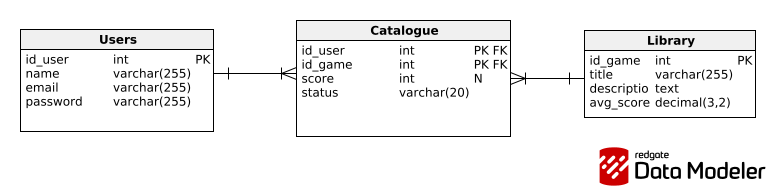

# Web-MyGameList

Servidor web creado por Valentina Bianchi y Maximo Billordo para la materia Programación Web, de la carrera Ingeniería de Sistemas de la UNICEN.

## Descripción

MyGameList es una aplicación para llevar un catálogo de los juegos favoritos de una persona. Para cada juego se guarda un título, una calificación (de 1 a 5 estrellas) y un estado (Por jugar, Jugando, Completado, Platinado).

## Modelo de datos

El esquema de la base de datos (PostgreSQL) está compuesto por tres tablas:

* **Users**: usuarios registrados en la aplicación (id, nombre, email, contraseña).
* **Library**: catálogo global de juegos disponibles (id, título, descripción, calificación promedio).
* **Catalogue**: tabla intermedia que representa la lista personal de cada usuario (qué juego tiene agregado, con qué puntaje y en qué estado).

El esquema completo se encuentra en `db/schema/schema.sql`, y las consultas SQL utilizadas para generar el código de acceso a datos están en `db/queries/queries.sql`.
### Modelo relacional

## Requisitos

* Si no está instalado, usar el siguiente comando para instalar docker-compose: `sudo apt install docker-compose-v2`
* Verificar la instalación con: `docker compose version`

## Cómo ejecutar el servidor

Todo corre dentro de contenedores Docker (API y PostgreSQL), sin instalar Go ni PostgreSQL en la máquina host. Desde la raíz del proyecto:

```bash
make run
```

Esto construye la imagen del servidor, levanta PostgreSQL con el esquema de `db/schema/schema.sql` y deja la API escuchando en `http://localhost:8080`. La API se compila al arrancar el contenedor, por lo que puede tardar unos segundos en responder. Se detiene con `Ctrl+C`, y `make clean` elimina los contenedores y los datos.
## API

| Recurso  | Método y URL                          | Descripción                              | Respuestas         |
| -------- | ------------------------------------- | ---------------------------------------- | ------------------ |
| Usuarios | `POST /users`                         | Crear usuario                            | 201, 400, 409      |
|          | `GET /users`                          | Listar usuarios                          | 200                |
|          | `GET /users/{id}`                     | Obtener usuario                          | 200, 400, 404      |
|          | `PUT /users/{id}`                     | Actualizar nombre y email                | 200, 400, 404, 409 |
|          | `DELETE /users/{id}`                  | Eliminar usuario                         | 204, 400, 404      |
| Juegos   | `POST /library`                       | Crear juego                              | 201, 400           |
|          | `GET /library`                        | Listar juegos                            | 200                |
|          | `GET /library/{id}`                   | Obtener juego                            | 200, 400, 404      |
|          | `PUT /library/{id}`                   | Actualizar título y descripción          | 200, 400, 404      |
|          | `DELETE /library/{id}`                | Eliminar juego                           | 204, 400, 404      |
| Catálogo | `POST /catalogues/{idUser}`           | Agregar un juego al catálogo del usuario | 201, 400, 404, 409 |
|          | `GET /catalogues/{idUser}`            | Listar el catálogo del usuario           | 200, 400, 404      |
|          | `GET /catalogue/{idUser}/{idGame}`    | Obtener un registro                      | 200, 400, 404      |
|          | `PUT /catalogue/{idUser}/{idGame}`    | Actualizar puntaje y estado              | 200, 400, 404      |
|          | `DELETE /catalogue/{idUser}/{idGame}` | Quitar el juego del catálogo             | 204, 400, 404      |

Los cuerpos de las peticiones y respuestas son JSON. Los errores devuelven un mensaje de texto. Los ejemplos completos están en `requests.hurl`.

## Cómo probar la API

Las pruebas están escritas con `Hurl` en `requests.hurl`, y se ejecutan con un único comando:

```bash
make api-test
```

Esto ejecuta, en orden:

1. Limpieza de cualquier contenedor o volumen previo (`docker compose down -v`), para partir de una base vacía.
2. Construcción de la imagen del servidor (`docker compose build server`), que incluye Hurl.
3. Levantamiento de PostgreSQL, esperando a que esté listo para aceptar conexiones (`healthcheck`).
4. Levantamiento de la API, esperando a que su propio `healthcheck` confirme que responde.
5. Ejecución de `requests.hurl` dentro del contenedor del servidor, sin necesidad de instalar Hurl en la máquina host.
6. Limpieza de los contenedores y volúmenes al finalizar, tanto si las pruebas pasaron como si fallaron.

Para correr las pruebas a mano contra un servidor ya levantado con `make run`, con Hurl instalado en la máquina host (`hurl --test requests.hurl`), hace falta una base recién creada (`make clean` antes), porque el archivo asume que los ids empiezan en 1 y que las listas están vacías al comienzo.

## Cómo correr los tests de la capa de datos

Todo el flujo de testing está automatizado con un `Makefile`, que se apoya en `docker compose` para levantar una base de datos PostgreSQL limpia, generar el código con `sqlc`, compilar el proyecto y correr los tests, sin necesidad de tener PostgreSQL, Go ni `sqlc` instalados en la máquina host (todo corre dentro de contenedores Docker).

Para correr los tests, desde la raíz del proyecto:

```bash
make test
```

Esto ejecuta, en orden:

1. Limpieza de cualquier contenedor o volumen previo (`docker compose down -v`).
2. Construcción de la imagen donde corren los tests (`docker compose build test`).
3. Levantamiento del contenedor de PostgreSQL, esperando a que esté listo para aceptar conexiones (`healthcheck`).
4. Dentro de un contenedor: generación del código con `sqlc generate`, compilación (`go build`) y ejecución de los tests (`go test ./... -v`).
5. Limpieza de los contenedores y volúmenes al finalizar, tanto si los tests pasaron como si fallaron.

## Decisiones de diseño (TP3)

**Estructura y rutas**
+ Al querer actualizar y borrar no se sabe si se encontró el usuario o no, por lo que se actualizaron los Delete y Update de `:exec` a `execrows` y ahora devuelven un `result` con la cantidad de *rows* afectadas
+ A la hora de borrar un usuario o juego se debe controlar que sucede con su id en catálogo, por lo que se agrega `ON DELETE CASCADE` en la FK de Catalogue - Users y en Catalogue - Library. Esto hace que borrar un usuario o juego elimina su catálogo y los juegos o usuarios respectivamente permanecen. Además que el `trg_update_avg_score` recalcula `avg_score`
- Recursos en plural (`/users`, `/library`). Para el catálogo se eligieron URLs planas con el usuario como parámetro, `/catalogues/{idUser}` para la colección y `/catalogue/{idUser}/{idGame}` para un registro, en lugar de anidarlo bajo `/users/{id}`.

**Códigos de estado**
- 201 al crear, 200 al leer y actualizar, 204 sin cuerpo al eliminar.
- 400 para JSON mal formado, ids no numéricos o datos inválidos.
- 404 cuando el recurso que identifica la URL no existe, detectado con `sql.ErrNoRows` en los `Get` y con las filas afectadas (`:execrows`) en `Update` y `Delete`.
- 409 ante duplicados: email repetido (`23505`) y juego ya presente en el catálogo del usuario.
- 500 para cualquier otro error de la base, con un mensaje genérico al cliente y el detalle solo en el log del servidor.
- Un dato inexistente que viaja en el cuerpo (`id_game` en `POST /catalogues/{idUser}`) devuelve 400, mientras que uno que identifica la URL devuelve 404.
- Un segundo `DELETE` sobre el mismo recurso devuelve 404: el estado final es el mismo, pero la respuesta cambia.

**Datos y respuestas**
- Las listas vacías se responden como `[]` y no como `null`.
- Ningún `GET` expone la contraseña, y `PUT /users/{id}` no la modifica.
- `avg_score` lo calcula un trigger al insertar, actualizar o borrar registros del catálogo. Por eso `PUT /library/{id}` no lo devuelve, y `POST /library` lo muestra en `0.00`.
- `score` es opcional: se expone como número, o `null` si no hay puntaje, mediante un override de tipos en `sqlc.yaml`.
- `PUT` reemplaza el registro completo: si el cuerpo no trae `score`, el puntaje anterior se borra.

**Docker y pruebas**
- Un único `Dockerfile` con tres etapas: `base` (Go, sqlc y dependencias), `test` (base más el código, para `make test`) y `server` (base más Hurl y el código, para `make run` y `make api-test`). Cada servicio del `docker-compose.yml` elige su etapa con `target`.
- Hurl se instala solo en la etapa `server`, antes de copiar el código, para que Docker no lo reinstale cada vez que cambia un archivo del proyecto.
- `make api-test` sigue el mismo flujo que `make test`, y limpia contenedores y volúmenes al terminar, pasen o fallen las pruebas.

## Limitaciones conocidas

- Por el momento no hay autenticación ni autorización: cualquier cliente puede leer y modificar cualquier recurso.
- No hay restricción de título único en `Library`.
